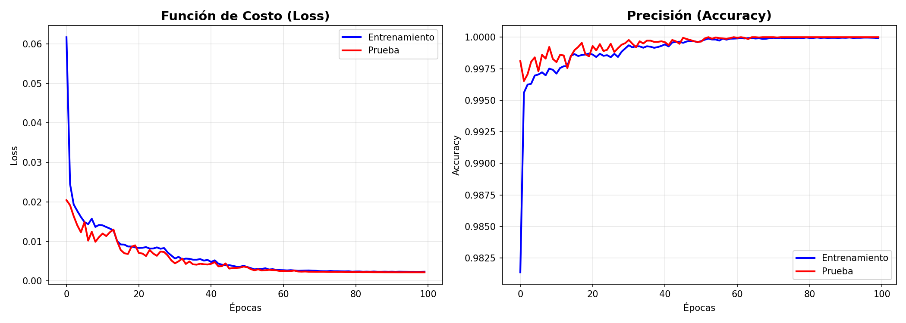
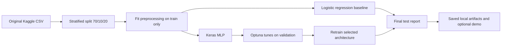

# House Purchase Decision Prediction

**A reproducible tabular deep-learning case study using TensorFlow/Keras, Optuna and careful holdout evaluation.**

   

> **Goal:** Predict whether a buyer decides to purchase a property (`decision`), **not** the property's price. This repository restructures a previous notebook assignment into reproducible ML code and fixes data leakage in its evaluation workflow.

## At a glance

| Item | Description |
| --- | --- |
| Dataset | [Global House Purchase Decision Dataset](https://www.kaggle.com/datasets/mohankrishnathalla/global-house-purchase-decision-dataset) (Kaggle) |
| Samples | 200,000 records reported in the original notebook |
| Features | 23 (19 numeric + 4 categorical), excluding `property_id` |
| Target | `decision`: no purchase (0) or purchase (1) |
| Original study | Keras MLP vs Optuna-optimized MLP, with optional MLflow tracking |
| New safeguards | Train-only preprocessing, stratified 70/10/20 split, validation-only Optuna search |
| Metrics | Accuracy, balanced accuracy, precision, recall, F1, ROC AUC, PR AUC (average precision), confusion matrix |
| Interactive demo | Optional Streamlit app that uses a freshly trained artifact |

## Historical experiment — illustrative only

The original notebook recorded exceptionally high accuracies. However, it fitted preprocessing before splitting and used the test split during tuning. Thus these figures below are **archived training-curve evidence, not validated independent-test claims**.



See [experimental results and caveats](docs/RESULTS.md) and [model card](docs/MODEL_CARD.md).

## Reproducible methodology



Note: Test metrics for separately trained candidate experiments are reported for comparison, not fed back into Optuna or early stopping. Avoid iterative selection based on test metrics.

## Project structure

```text
house-purchase-decision-ml/
├── app.py                         # Optional interactive inference interface
├── src/house_purchase/
│   ├── config.py                  # Columns and dataset configuration
│   ├── data.py                    # Download, split and train-only preprocessing
│   ├── model.py                   # Original and optimized MLP architectures
│   ├── experiments.py             # Baseline, training and Optuna search
│   ├── report.py                  # Metrics and curves
│   ├── predict.py                 # Inference on raw inputs
│   └── cli.py                     # Command-line interface
├── notebooks/
│   └── 01_data_overview.ipynb     # Clean exploratory walkthrough (no stored outputs)
├── docs/                          # Dataset, model card, security and results
├── assets/legacy/                 # Historic plots (clearly labeled)
├── tests/                         # Automated tests with fictitious fixtures
├── data/README.md                 # Download instructions; no data included
├── pyproject.toml
└── .github/workflows/tests.yml
```

## Quick start (Windows PowerShell)

Requires Python **3.10–3.12**, depending on the available TensorFlow builds for your machine.

```powershell
git clone https://github.com/Slowpokeislife/house-purchase-decision-ml.git
cd house-purchase-decision-ml
py -3.11 -m venv .venv
.\.venv\Scripts\Activate.ps1
python -m pip install --upgrade pip
pip install -e ".[train,app]"
```

If you downloaded this repo as a ZIP, extract it and skip the `git clone` command. The GitHub link will work once you create the remote repository under that name.

### Download the original public dataset

```powershell
house-purchase download
```

Alternatively, download it from the [Kaggle dataset page](https://www.kaggle.com/datasets/mohankrishnathalla/global-house-purchase-decision-dataset) and save as `data/raw/global_house_purchase_dataset.csv`. No CSVs are shipped in the repo. Review the dataset terms before reuse.

### Train a simple benchmark

```powershell
house-purchase baseline
```

### Train the historical architectures with corrected methodology

```powershell
house-purchase train --architecture original
house-purchase train --architecture optimized
```

The `optimized` command uses the **historically selected hyperparameters** (224-64-48-48, dropout 0.15, Adam LR ~0.001967). They are useful for reproducing that architecture, but were originally selected using an improper test/validation procedure: for an unbiased architecture search, run fresh Optuna below.

### Re-run Optuna correctly on validation only

```powershell
house-purchase tune --trials 20
```

Optuna stores its study locally in ignored `artifacts/tuned/optuna.db` and chooses hyperparameters by **validation average precision**. `test` is reserved for the final evaluation following selection. Use `--trials 2 --trial-epochs 3 --final-epochs 5` for a basic smoke test (not a performance benchmark).

### Optional Streamlit demo

```powershell
streamlit run app.py
```

Choose a locally trained model, enter hypothetical housing/buyer features, and obtain a model score. No real customer data should be entered. Do not interpret this research demo as financial advice.

### Optional experiment tracking

```powershell
pip install -e ".[tracking]"
house-purchase train --architecture optimized --tracking
```

Tracking is **local by default** (`./mlruns`). To connect to a remote provider, configure your own credentials privately and set `MLFLOW_TRACKING_URI` locally; no DagsHub account is embedded or required.

### Run tests

```powershell
pip install -e ".[dev]"
pytest -q
```

## Why validation quality matters

The original notebook's optimized 40,000-row `test` confusion matrix was `[[30787, 0], [0, 9213]]`; its separate 20,000-row validation confusion matrix was also perfect. Yet the old test split guided Optuna and training callbacks, and the encoder/scaler were fitted globally. Furthermore, a synthetic/structured decision label may be unusually easy to reconstruct. This project explicitly distinguishes those **historical numbers** from results that a user recomputes under a stricter protocol. For this imbalanced target (~23% positive), PR-AUC and per-class errors matter more than accuracy alone.

## What I learned

- Building tabular neural networks and translating an experiment notebook into a maintainable Python package.
- Handling heterogeneous data with scaling, one-hot encoding, and strict train/test separation.
- Training with class weighting, dropout, batch normalization, L2 regularization, and early stopping.
- Automating hyperparameter search with Optuna while keeping the final test set untouched.
- Using MLflow locally and creating reproducible artifacts, tests and an interactive inference demo.
- Auditing overoptimistic model scores for preprocessing leakage and experiment-design problems.

## Ethics, provenance and limitations

This is an **educational** ML project, not a real decision system for banks, real estate, or credit underwriting. Buyer financial attributes should not be used to evaluate real people without a completely separate validation, privacy, bias and legal review. The source code is MIT-licensed; the Kaggle dataset remains subject to its publisher's own terms. No raw data, precomputed splits, local model files or credentials are included.

**Dataset credit:** [Global House Purchase Decision Dataset — mohan krishna thalla on Kaggle](https://www.kaggle.com/datasets/mohankrishnathalla/global-house-purchase-decision-dataset).

**Documentation:** [Dataset](docs/DATASET.md) · [Model card](docs/MODEL_CARD.md) · [Results](docs/RESULTS.md) · [Security](docs/SECURITY.md)
